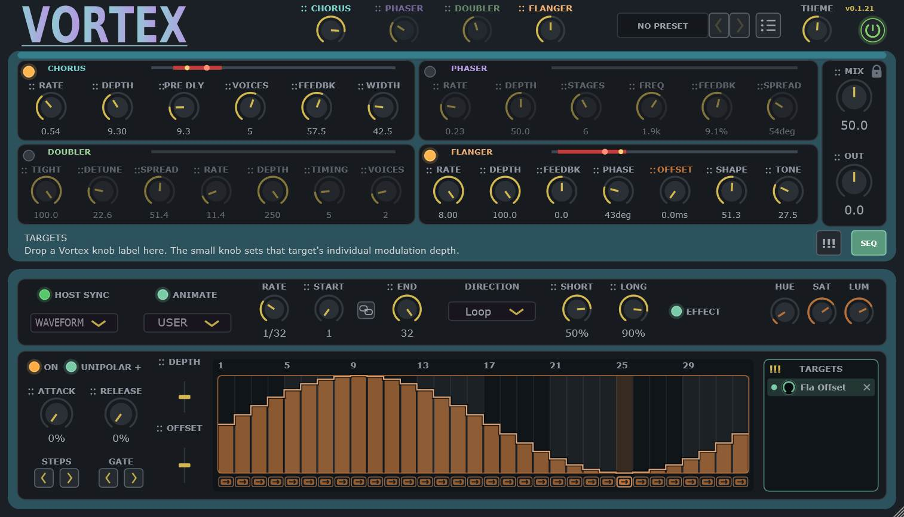

# Vortex

<div align="center">

[](https://github.com/sl2365/Vortex/releases/latest/download/Vortex.rar)
[](https://github.com/sl2365/Vortex/releases)
[](https://github.com/sl2365/Vortex/releases/latest)
[](https://github.com/sl2365/Vortex/releases)

</div>



Vortex is a Windows x64 VST3 modulation effect that combines **Chorus, Phaser, Flanger and Vocal Doubler** in one plug-in. Use an individual effect for traditional modulation, or enable several at once to build layered textures. Each effect has its own controls, on/off switch, live modulation guide and level, while a shared 32-step parameter sequencer offers more elaborate rhythmic movement.

The interface is designed for immediate adjustment: the four effects remain visible together, and the more powerful modulation and gate tools can be opened when needed. Click the Vortex logo for a zoom menu offering **75% to 300%**, in 25% increments. Manual window resizing is also supported; the selected size is saved for later use.

Credits: Many thanks to Artvera for the logo.

## Getting started

1. Load Vortex as an audio effect on a track in your VST3-compatible Windows DAW.
2. Switch on **CHORUS**, **PHASER**, **FLANGER** or **DOUBLER** using the amber LED at the top-left of its panel. Switch the other effects off to hear one at a time.
3. Set the main **MIX** control to around **50%** as a starting point, and use **OUT** to adjust overall output level.
4. Turn **RATE** and **DEPTH** to explore the modulation. Chorus, Phaser and Flanger also have a **WAVE** knob to choose the movement shape.
5. Enable additional effects and adjust the four small top-row **LEVEL** knobs to balance them. Open the sequencer when you want programmed changes.

Each effect is processed in parallel, not in series. The main MIX sets the overall dry/wet balance; individual LEVEL controls adjust only their effect's processed sound.

## The four effects

### Chorus

Adds moving, layered copies of the original sound. Use it for subtle width, lush ensembles or stronger swirling modulation.

| Control | What it does |
|---|---|
| **RATE** | Sets modulation speed, from 0.01 to 10 Hz. |
| **DEPTH** | Sets delay-time modulation, from 0 to 24 ms. |
| **PRE DLY** | Sets the starting delay, from 0 to 50 ms. |
| **VOICES** | Selects 1 to 8 chorus voices; more voices can produce a denser, wider sound. |
| **FEEDBK** | Adds regeneration, from 0 to 100%, for more pronounced modulation. |
| **WIDTH** | Sets stereo width, from 0 to 200%. |
| **WAVE** | Selects one of eight LFO shapes. |

For a gentle chorus, begin with low Feedback and moderate Rate and Depth. For a bigger ensemble, increase Voices and Width before adding Feedback.

### Phaser

Creates moving frequency cancellations and peaks. It can produce a subtle sweep or more pronounced resonant movement.

| Control | What it does |
|---|---|
| **RATE** | Controls the speed of the frequency sweep. |
| **DEPTH** | Controls how far the sweep travels. |
| **STAGES** | Selects the phaser's all-pass stages (2 to 12 poles). |
| **FREQ** | Sets the centre frequency, from 75 Hz to 7.5 kHz. |
| **FEEDBK** | Adds positive or negative feedback, from -90% to +90%. |
| **SPREAD** | Sets left/right LFO phase difference, from 0 to 180 degrees. |
| **WAVE** | Selects one of eight LFO shapes. |

Start with a slow Rate and moderate Depth. Increase Feedback to accentuate the effect, or adjust FREQ to move the sweep into a different frequency region.

### Flanger

Uses a short, changing delay to generate a sweeping comb-filter effect. It can range from mild movement to pronounced metallic resonance.

| Control | What it does |
|---|---|
| **RATE** | Controls sweep speed. |
| **DEPTH** | Controls delay-time sweep depth. |
| **FEEDBK** | Sets negative or positive feedback, from -100% to +100%. |
| **PHASE** | Offsets the left/right LFOs, from 0 to 180 degrees. |
| **OFFSET** | Sets base delay time, from 0 to 12 ms, changing the comb-filter position. |
| **WAVE** | Selects one of eight LFO shapes. |
| **TONE** | Ranges from heavily low-pass filtered at 0% to unfiltered at 100%. |

Try changing OFFSET and TONE with Feedback raised to explore different resonances. Very high feedback can be intense, so monitor the output level.

### Doubler

Creates up to eight additional, independently moving voices. It is intended for thickening vocals, synths, guitars and other sounds, rather than precise, formant-preserving pitch correction.

| Control | What it does |
|---|---|
| **TIGHT** | Adjusts how closely the simulated doubles follow the source. |
| **DETUNE** | Introduces independent pitch differences between voices. |
| **SPREAD** | Separates the voices across the stereo field. |
| **RATE** | Sets the speed of the pitch movement. |
| **DEPTH** | Sets the amount of pitch movement. |
| **TIMING** | Adds delay offsets, from 0 to 800 ms. |
| **VOICES** | Selects 1 to 8 doubled voices. |

For a natural double, start with several voices, moderate Spread and short Timing. Larger Timing settings can sound like distinct repeats rather than tightly layered performances.

## Waveforms and live modulation guides

Chorus, Phaser and Flanger share eight **WAVE** choices: **Sine, Triangle, Sawtooth, Ramp, Exponential, Inverse Exponential, Random and Rounded Square**. Their individual RATE knobs control how quickly those waveforms move.

Each effect panel also has a red modulation guide next to its heading:

- **Chorus:** Shows the moving delay-time range.
- **Phaser:** Shows the frequency sweep and its left/right positions.
- **Flanger:** Shows the short-delay sweep and its left/right positions.
- **Doubler:** Shows the timing spread of the doubled voices, with two representative moving markers.

The guides reflect the effects' modulation rather than controlling it. When an effect is off, its guide becomes a stationary grey bar.

## Switching and balancing effects

The **amber LED** in each panel switches that effect on or off. When an effect is off, its knobs and readouts are **dimmed but still adjustable**. This lets you prepare a different sound while the effect is silent, then bring it back in for performance.

The four coloured LEVEL labels and their small knobs in the top row set independent wet levels for **CHORUS**, **PHASER**, **DOUBLER** and **FLANGER**. Each runs from **0% to 200%**, with **100%** as unity gain. Use these to balance the effects; use the main MIX for their combined dry/wet blend and OUT for final output level.

The master power button bypasses Vortex's effect processing as a whole. Disabled effects and a fully bypassed plug-in also avoid unnecessary expensive DSP calculations to reduce CPU use.

## Using the 32-step sequencer

Open the expandable sequencer panel to automate Vortex's controls rhythmically. It provides **32 steps**, up to **16 parameter target slots**, adjustable target depths, host sync or free-run timing, direction, step shapes and gate patterns.

1. Switch the sequencer on and choose host sync or a free-running rate.
2. Draw a pattern by clicking or dragging vertically in the step grid, or choose one of the sequencer's waveform presets.
3. Drag a supported parameter label's `::` assignment handle into a target slot, or select a target in the slot controls.
4. Enable the target and set its individual depth to decide how strongly the pattern moves that parameter.
5. Adjust the step range, direction, attack, release, depth and offset to refine the movement.

The sequencer has its **own pattern waveforms**; these are separate from the Chorus, Phaser and Flanger WAVE knobs. Assigned effects can also be adjusted manually. When an effect is switched off, its knobs display the actual editable values rather than frozen sequencer-animated positions.

### Gate routing

The sequencer's gate section has four routing modes:

| Gate mode | What is gated |
|---|---|
| **OFF** | Nothing. The gate pattern has no effect on the sound. |
| **INPUT** | Only the dry signal; sound feeding the effects continues, so the effect tails can pass through. |
| **EFFECT** | Only the combined effected (wet) signal. |
| **OUTPUT** | Both dry and effected signals together. |

Create a gate pattern with open and closed steps, then choose the routing mode that suits the result. The gate has separate short and long step lengths.

## Presets and sequences

The top-row preset area allows you to step through presets, open the preset browser and use **Save** or **Save As**. The browser includes folders and favourites. Vortex preset files use the `.vortexpreset` extension and are kept in the plug-in's portable Presets folder.

To save a sequencer pattern, use **Save Sequence...** in the step-grid menu. Saved `.vortexseq` files appear in the sequencer's **USER** selection list. Sequences are stored separately from complete effect presets.

### Portable data location

Vortex keeps its data in a `Vortex_Data` folder beside the `Vortex.vst3` plug-in:

```text
Vortex.vst3
Vortex_Data/
    Settings/
    Presets/
    Sequences/
```

The folder is created when needed. `Settings` holds interface settings such as zoom; `Presets` contains full plug-in presets; and `Sequences` stores saved step patterns. Keep `Vortex_Data` with the plug-in when transferring a portable installation.

## Interface tips

- **THEME:** At **0%**, the original vortex image is fully visible across the two backgrounds. Turning toward **50%** fades the image to the plain charcoal surround. From **50% to 100%**, the original solid aqua colour fades in. The dark effect/knob panels remain opaque throughout. The two background panels retain their separate boundaries and dark gap.
- **Zoom:** Click the Vortex logo and choose 75%–300% in 25% increments. You can also resize the window manually.
- **Context help:** Move the pointer over a control to read its short explanation at the bottom of the interface.
- **Bypassed effects:** Their controls stay editable, although the knobs and guides are dimmed.
- **MIX / OUT:** MIX balances the original sound against the combined effects; OUT controls the final output level.
- **Sequencer assignments:** Parameter labels with `::` can be used to assign modulation targets.

---

## Build and development information

### Requirements

- **Platform:** Windows x64, VST3-compatible DAW.
- **Source framework:** JUCE 9.0.4 and C++17.
- **Build environment:** Visual Studio Community 2026, Windows SDK and CMake 4.4.2, as expected by the included build script.
- **Project layout:** `_Projects\Vortex` beside `_Projects\_Tools`.
- **Shared tools:** `_Projects\_Tools\JUCE\_9.0.4` and `_Projects\_Tools\cmake\_4.4.2`.

### Building from source

1. Place the source files in `_Projects\Vortex` and keep your existing `_Projects\Vortex\Resources` folder intact.
2. Confirm that `Resources\logo.png` or `Resources\logo.svg` exists. The build embeds `logo.png` if available, otherwise it uses the SVG fallback. Also keep the new `Resources\vortex_backdrop.png` image; it is embedded during the build.
3. Double-click `_Projects\Vortex\- Build.bat`.
4. Read `_Projects\Vortex\Results.log` if the build fails. A successful build writes `dist\Vortex.vst3`.

The build script does **not** install the plug-in automatically. The documentation image at the top of this README uses `Resources/Vortex.jpg`, while the plug-in interface embeds `Resources/logo.png` (or the SVG fallback); these are separate files.

### Technical details

| Item | Value |
|---|---|
| Current version | **v1.24.11** |
| Plug-in format | Windows x64 VST3 audio effect |
| Company | Dead Channel Audio |
| Manufacturer / plug-in codes | `sl23` / `vtx1` |
| Bundle identifier | `com.sl23.vortex` |
| State root | `VortexParameters` |
| Preset extension | `.vortexpreset` |
| Sequence extension | `.vortexseq` |
| Runtime data folder | `Vortex_Data` beside the VST3 |
| Audio framework | JUCE 9.0.4 |

The project was developed from the stripped Dusk/Afterglow interface template. It retains the original 32-step sequencer and 16 assignable target slots, with additional targets for Vortex's effects and waveforms. The effect engines use parallel wet routing, parameter smoothing and per-engine bypass fades. Inactive effects continue to skip their expensive DSP once their bypass fades finish. This version also reduces active-engine CPU work through cached stationary control calculations, cheaper delay-buffer indexing, an accurately interpolated phaser coefficient lookup, and fewer redundant Doubler reads. Isolated numerical tests passed; full Windows VST3 CPU measurements remain outstanding.

### Verification and compatibility

The source has undergone static consistency checks, but the **v1.24.11 Windows build and complete DAW regression test have not been independently verified in this environment**. Before publishing a release, check all four engines, live guides, waveform changes, gate routing, sequencer target assignments, presets, zoom, CPU use and stereo/mono behaviour in the intended hosts.

Because Vortex has not previously been released, compatibility with older development presets and automation mappings is not guaranteed. There is no migration from the earlier prototype data-folder names.
